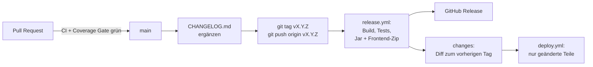

# Release- und Versionierungskonzept – TicTacTest

Wie aus einem Commit auf `main` eine Version wird, die man herunterladen und im Browser
spielen kann. Die Versionierung des DevContainer-Images ist ein eigenes Konzept mit
eigenen Tags, siehe [docs/DEVCONTAINER.md](docs/DEVCONTAINER.md), Kapitel 4.

## 1. Versionsschema

Die App wird nach **[Semantic Versioning 2.0.0](https://semver.org/lang/de/)** versioniert:
`MAJOR.MINOR.PATCH`, als Git-Tag mit `v` davor (`v1.6.0`).

| Teil | wird erhöht, wenn … | Beispiel |
|---|---|---|
| **MAJOR** | sich die Bedienung inkompatibel ändert: andere Eingabe der Züge, anderes Spielbrett, das Frontend passt nicht mehr zu älteren Backends | Züge als `A1` statt `0`–`8` |
| **MINOR** | etwas Neues dazukommt, das Bestehendes nicht bricht | neuer Gegner, neue Anzeige im Frontend, Version im Manifest |
| **PATCH** | ein Fehler behoben wird, ohne neue Funktion | Tippfehler in den Spielregeln, Bugfix im Spiel |

Regeln:

- **Eine Version ist unveränderlich.** Ein Tag wird nie verschoben oder neu vergeben. Ein
  Fehler in einem Release wird mit einem neuen Release behoben, nicht durch Überschreiben.
- Die Version steht **nur im Tag**. Gradle bekommt sie beim Build (`-Pversion`), das
  Frontend als `version.json`, das Backend schreibt sie als `version.txt` neben das Jar.
  Keine Datei im Repository muss von Hand angepasst werden.
- Tags `devcontainer-v*` gehören zum DevContainer-Image. Sie beginnen nicht mit `v` und
  lösen keinen App-Release aus.
- Backend und Frontend haben **eine gemeinsame Version**: Ein Release enthält immer beide
  Artefakte, deployt wird aber nur, was sich geändert hat. Deshalb kann das Backend z. B.
  `1.5.0` melden, während das Frontend `1.3.0` zeigt, wenn `v1.4.0` und `v1.5.0` das
  Frontend nicht verändert haben.

## 2. Inhalt eines Releases

Jeder Tag `v*` erzeugt mit [`release.yml`](.github/workflows/release.yml) einen GitHub
Release:

| Asset | Inhalt |
|---|---|
| `tictactoe-X.Y.Z.jar` | das Spiel, lauffähig mit `java -jar`, Version im Manifest (`Implementation-Version`) |
| `tictactest-frontend-X.Y.Z.zip` | Inhalt von [`frontend/`](frontend/) ohne `config.js`, mit `version.json` = `X.Y.Z` |
| Release Notes | automatisch aus den Commits und Pull Requests seit dem vorherigen Release (`--generate-notes`) |

Das sind die **einzigen Artefakte, die deployt werden**. Für ein Deployment wird nichts neu
gebaut. Ein Rollback auf eine alte Version liefert exakt die damaligen Dateien aus.

## 3. Ablauf eines Releases



1. **Änderungen kommen per Pull Request auf `main`.** `main` ist geschützt: Der PR braucht
   grüne Checks *Build, Test, Coverage & Mutation* und *Compare (PASS / FAIL)* (Coverage
   darf nicht sinken). Direkte Pushes auf `main` sind gesperrt.
2. **Version festlegen** nach Abschnitt 1, ausgehend vom letzten Tag (`git describe --tags --abbrev=0 --match 'v[0-9]*'`).
3. **[`CHANGELOG.md`](CHANGELOG.md) ergänzen**: Abschnitt `[Unreleased]` in die neue Version
   umbenennen, mit Datum, per Pull Request auf `main`.
4. **Tag setzen** auf dem Merge-Commit:
   ```bash
   git switch main && git pull
   git tag v1.7.0
   git push origin v1.7.0
   ```
5. **`release.yml` läuft automatisch:** baut mit Tests und Coverage-Gate (`./gradlew build`),
   erstellt Jar und Frontend-Archiv, veröffentlicht den Release. Bei Serverfehlern von
   GitHub (5xx) wiederholt er das Anlegen bis zu dreimal und entfernt halbfertige Drafts.
6. **Deployment:** Der Job `changes` vergleicht mit dem vorherigen Release-Tag, `deploy.yml`
   deployt nur Backend und/oder Frontend, falls geändert, und prüft danach die laufende
   Version. Details: [docs/deployment.md](docs/deployment.md).
7. **Kontrolle:** Release auf GitHub vorhanden mit beiden Assets, Workflow grün,
   `/version` und `version.json` melden die neue Version.

Vorher, falls die Lab-Session neu ist: die AWS-Secrets in GitHub erneuern (sonst bricht
nur das Deployment ab, der Release selbst entsteht trotzdem).

## 4. Wenn etwas schiefgeht

| Situation | Vorgehen |
|---|---|
| Fehler im laufenden Release | **Rollback:** *Actions → Deploy → Run workflow* mit dem letzten guten Tag. Danach Fehler beheben und als neuen PATCH-Release veröffentlichen. |
| Release-Build rot (Tests, Coverage) | Es entsteht kein Release. Fehler per PR beheben, **neue** Version taggen; den fehlerhaften Tag nicht wiederverwenden. |
| Release unvollständig (Asset fehlt) | Das Deployment bricht ab, die laufende Version bleibt. Release auf GitHub löschen (Tag behalten) und den Release-Workflow neu starten, oder einen neuen PATCH-Release erstellen. Beispiel: `v1.4.0`, siehe Changelog. |
| Deployment rot (Credentials abgelaufen, Instanz nicht erreichbar) | Der Release ist trotzdem gültig. Ursache beheben, dann *Run workflow* mit demselben Tag. |

## 5. Versionen und Umgebungen

Heute gibt es eine Umgebung, jeder Release geht direkt dorthin. Wie Releases über
`dev → staging → prod` befördert würden (gleiches Artefakt, Freigabe über GitHub
Environments), steht in [docs/deployment.md](docs/deployment.md), Teil C.
