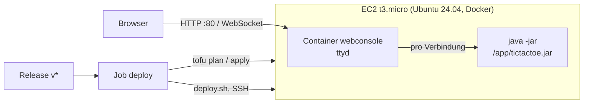

# Deployment – TicTacTest in der Cloud

Das Release-JAR läuft **unverändert** im Browser: [ttyd](https://github.com/tsl0922/ttyd)
stellt ein Terminal als Webseite bereit und startet für jede Verbindung
`java -jar tictactoe.jar`. Der Server ist eine EC2-Instanz, beschrieben mit OpenTofu.
Bei jedem Release deployt GitHub Actions **nur die Teile, die sich geändert haben**.



| Teil | Dateien | Wann wird deployt? | Was passiert |
|---|---|---|---|
| **infra** | [`infra/*.tf`](../infra/), [`cloud-init.yaml`](../infra/cloud-init.yaml) | `tofu plan` findet Änderungen | `tofu apply` |
| **jar** | Release-Asset `tictactoe-X.Y.Z.jar` | Hash der JAR-Einträge ≠ Hash auf dem Server | JAR in `/opt/tictactest/app` ersetzen; laufende Spiele behalten das alte, neue Verbindungen starten das neue |
| **webconsole** | [`webconsole/Dockerfile`](../webconsole/Dockerfile), [`compose.yaml`](../webconsole/compose.yaml) | Hash der Dateien ≠ Hash auf dem Server | hochladen, `docker compose up --build` |

---

## Auftrag 1 – Web-Konsole lokal

```bash
mkdir -p webconsole/app
cp build/libs/tictactoe.jar webconsole/app/        # oder das JAR aus dem GitHub Release
docker compose -f webconsole/compose.yaml up --build
```

→ <http://localhost:8080>. Nach Spielende beendet sich das JAR, ttyd bietet
*Press ⏎ to Reconnect* an – das startet eine neue Partie.

- Das JAR ist **nicht** im Image, sondern wird als Verzeichnis `./app` eingebunden.
  Ein neues Release tauscht nur diese Datei, das Image bleibt.
- ttyd ist als statisches Binary mit fester Version und **SHA-256-Prüfsumme** eingebunden.
- Container: eigener User ohne Rechte, Dateisystem read-only, `no-new-privileges`,
  höchstens 10 gleichzeitige Spieler, je JVM 32 MB Heap.

## Auftrag 2 – Infrastruktur mit OpenTofu

| Ressource | Zweck |
|---|---|
| `aws_instance.web` | t3.micro, Ubuntu 24.04; `cloud-init.yaml` installiert Docker und legt `/opt/tictactest` an |
| `aws_eip.web` | feste IP: bleibt beim Stop/Start des Learner Labs und beim Ersetzen der Instanz |
| `aws_security_group.web` + Regeln | eingehend 80 (Spiel) und 22 (Deployment), ausgehend alles |
| `aws_key_pair.deploy` | Public Key [`infra/deploy_key.pub`](../infra/deploy_key.pub); der private Schlüssel ist das Secret `SSH_PRIVATE_KEY` |

Der **State liegt in S3** (`tictactest-tfstate-730335265764`, versioniert, Lock per
`use_lockfile`), damit lokale Läufe und die Pipeline dieselbe Infrastruktur sehen.

### Einmalig einrichten

```bash
# AWS-Credentials aus dem Learner Lab (AWS Details → AWS CLI) nach ~/.aws/credentials
aws s3api create-bucket --bucket tictactest-tfstate-730335265764 --region us-east-1
aws s3api put-bucket-versioning --bucket tictactest-tfstate-730335265764 \
  --versioning-configuration Status=Enabled
ssh-keygen -t ed25519 -N "" -C tictactest-deploy -f ~/.ssh/tictactest_deploy
cp ~/.ssh/tictactest_deploy.pub infra/deploy_key.pub
```

### Von Hand deployen

```bash
cd infra
tofu init
tofu plan -out=tfplan        # prüfen, was passiert
tofu apply tfplan
cd ..
SSH_KEY=~/.ssh/tictactest_deploy .github/scripts/deploy.sh "$(tofu -chdir=infra output -raw public_ip)" build/libs/tictactoe.jar
```

Ein zweiter Aufruf ohne Änderung meldet `jar: unverändert, übersprungen` und
`webconsole: unverändert, übersprungen`.

## Auftrag 3 – Release-basiertes Deployment

Der Job `deploy` in [`release.yml`](../.github/workflows/release.yml) läuft nach
dem Job `release`, also bei jedem Tag `v*`:

1. **Release-JAR herunterladen** – genau das Asset des Releases, kein neuer Build.
2. **Infrastructure** – `tofu plan -detailed-exitcode`: Exit-Code `0` → übersprungen,
   `2` → `tofu apply` des geprüften Plans, sonst Fehler.
3. **Jar and web console** – [`deploy.sh`](../.github/scripts/deploy.sh) vergleicht pro
   Teil einen SHA-256 mit `/opt/tictactest/.deployed-<teil>` auf dem Server und
   deployt nur bei einem Unterschied.

Die Zusammenfassung des Laufs zeigt pro Teil *deployt* oder *übersprungen*.

**Warum Hashes statt `git diff` zum letzten Tag?** Verglichen wird mit dem, was
wirklich auf dem Server läuft. Schlägt ein Deployment fehl, holt das nächste es
nach; eine neu erstellte Instanz (geänderte `cloud-init.yaml`) hat keine Hashes und
bekommt alles. Der JAR-Hash umfasst Namen und Inhalt der Einträge, nicht die
ZIP-Datei: ein Release, das nur Doku ändert, baut ein JAR mit neuen Zeitstempeln,
aber gleichem Inhalt – es wird nicht neu deployt.

### Secrets (*Settings → Secrets and variables → Actions*)

| Secret | Wert |
|---|---|
| `AWS_ACCESS_KEY_ID` | Learner Lab → *AWS Details* → *AWS CLI* |
| `AWS_SECRET_ACCESS_KEY` | dito |
| `AWS_SESSION_TOKEN` | dito |
| `SSH_PRIVATE_KEY` | Inhalt von `~/.ssh/tictactest_deploy` |

Die Learner-Lab-Credentials gelten nur für eine Lab-Session (≈ 4 h). Vor einem
Release müssen die drei AWS-Secrets erneuert werden, sonst schlägt der Schritt
*Infrastructure* mit `ExpiredToken` fehl.

### Release auslösen

```bash
git tag v1.0.0 && git push origin v1.0.0
```

## Hinweise

- Im **Schulnetz** liefert `http://<IP>/` ein `403 Forbidden` des Webfilters (nicht
  vom Server). Über ein anderes Netz (Handy-Hotspot) oder per SSH-Tunnel
  `ssh -i ~/.ssh/tictactest_deploy -L 8081:localhost:80 ubuntu@<IP>` → <http://localhost:8081>.
- SSH ist für `0.0.0.0/0` offen, weil GitHub-Runner keine festen Adressen haben;
  Anmeldung nur mit dem Deploy-Key.
- Aufräumen: `tofu -chdir=infra destroy`.
