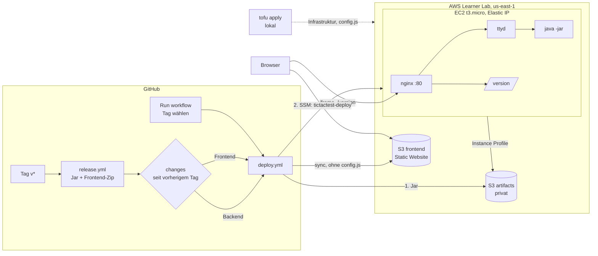
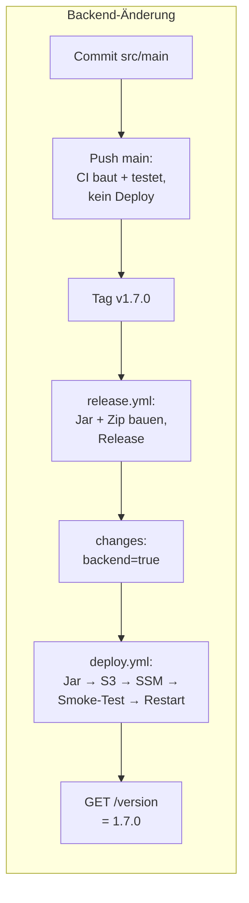
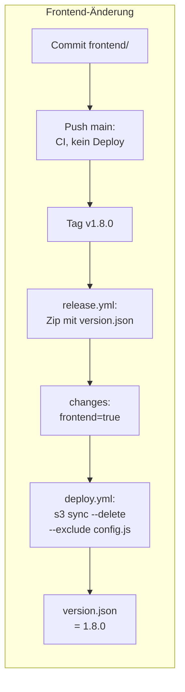
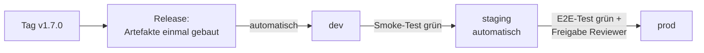

# Deployment – TicTacTest in der Cloud (Aufträge 2 und 3)

**Spielen:** <http://tictactest-frontend-83d63465599e.s3-website-us-east-1.amazonaws.com/>

Web-Konsole und Frontend: siehe [webkonsole.md](webkonsole.md) (Auftrag 1).



---

## Teil A – Infrastruktur (Auftrag 2)

### Infrastruktur und Applikation getrennt

| | Wer | Wann |
|---|---|---|
| **wohin und wie**: Instanz, Java, ttyd, nginx, systemd-Unit, Deploy-Befehl, Buckets, Frontend-Hosting, `config.js` | OpenTofu ([`infra/`](../infra/)), **nur lokal** `tofu apply` | selten, bei Änderungen an der Infrastruktur |
| **welche Version**: Jar und Frontend eines Releases | Deployment ([`deploy/`](../deploy/), [`deploy.yml`](../.github/workflows/deploy.yml)) | bei jedem Release, Rollback |

Das Jar kommt **nicht** über `user_data`. Stünde dort `curl …/v1.2.0/tictactoe.jar`, bräuchte
jede neue Version eine Änderung an `user_data`. Mit `user_data_replace_on_change = true`
hiesse das: jedes Release eine neue Instanz. Ohne diese Option wird geänderte `user_data`
gar nicht mehr ausgeführt (cloud-init läuft nur beim ersten Start), die neue Version käme
nie an. Beides ist falsch. `user_data` richtet hier nur die Laufzeitumgebung ein.

### Ressourcen

| Ressource | Zweck |
|---|---|
| `aws_instance.web` | t3.micro, Amazon Linux 2023, `LabInstanceProfile`, IMDSv2 |
| `aws_eip.web` | feste Adresse, überlebt Stop/Start der Session und eine ersetzte Instanz |
| `aws_security_group.web` + Regeln | siehe unten |
| `terraform_data.artifact_bucket` + Public Access Block | privater Bucket für die Release-Jars und den Stand `state/backend-version` |
| `terraform_data.frontend_bucket` + Public Access Block, Policy, Website | öffentliches Frontend (S3 Static Website) |
| `aws_s3_object.frontend_config` | `config.js` mit der URL der Web-Konsole |
| `data.aws_iam_instance_profile.lab` | vorhandenes Profil, eigene IAM-Rollen sind im Learner Lab verboten |

**Einrichtung beim ersten Start** ([`cloud-init.yaml.tftpl`](../infra/cloud-init.yaml.tftpl)):

- `java-25-amazon-corretto-headless-25.0.5.0.10` und `nginx-1.30.6` mit **fester Version**.
  Das Repository von Amazon Linux 2023 ist an das AMI gebunden (`ignore_changes = [ami]`).
- **ttyd 1.7.7** ist nicht im Repository: statisches Binary von GitHub, geprüft mit
  `sha256sum --check` gegen die Prüfsumme in `main.tf`. Stimmt sie nicht, bricht
  cloud-init ab.
- systemd-Unit `tictactest.service`: startet beim Booten, `Restart=always`, läuft als
  `tictactest` (kein root, keine Shell), `NoNewPrivileges`, `ProtectSystem=strict`.
- `/usr/local/bin/tictactest-deploy <version>`: der einzige Weg, eine Version zu
  installieren (siehe Teil B).

Geprüft über SSM nach dem `apply`: `cloud-init status: done`, `openjdk 25.0.5`,
`ttyd 1.7.7`, nginx aktiv, Dienst aktiviert.

**Security Group:**

| Regel | Begründung |
|---|---|
| eingehend TCP 80 von überall | das Spiel und `/version`, für alle Besucher |
| ausgehend TCP 443 | S3 (Jar holen), SSM-Agent, Paket-Repository, ttyd-Download |
| *kein* SSH (22) | Das Deployment läuft über SSM: kein offener Port, kein Schlüssel, der verloren gehen kann |
| *kein* 7681 | ttyd lauscht nur auf `localhost`, nur nginx ist erreichbar |

DNS, NTP und der Metadaten-Dienst filtert eine Security Group nicht.

### Wie kommt das Jar auf die Instanz? – S3 + SSM

| Variante | Bewertung |
|---|---|
| Instanz lädt vom GitHub Release | Ist das Repository privat, braucht die Instanz ein GitHub-Token, ein Secret auf dem Server. |
| SSH/scp von aussen | Port 22 muss für alle GitHub-Runner offen sein (keine festen IPs), privater Schlüssel als Secret. |
| **privater S3-Bucket + SSM** – gewählt | Die Pipeline lädt das Jar in den Bucket und schickt mit `aws ssm send-command` den Befehl `tictactest-deploy 1.2.0`. Die Instanz holt das Jar mit dem **Instance Profile**. Es gibt keine Keys auf der Instanz, keinen offenen Port und kein zusätzliches Secret, denn die AWS-Credentials braucht die Pipeline ohnehin. SSM protokolliert jeden Befehl. |

**Welche Version nach einem Neustart?** `tictactest-deploy` legt jede Version in
`/opt/tictactest/releases/<version>/` ab (Jar + `version.txt`) und setzt den Symlink
`/opt/tictactest/current` atomar um. Die Unit startet immer `current/tictactoe.jar`. Die
EBS-Disk bleibt beim Stop erhalten, also läuft nach dem Start dieselbe Version.
Zusätzlich steht die zuletzt deployte Version in `s3://…artifacts…/state/backend-version`:
Eine **neu erstellte** Instanz installiert sie im letzten Schritt von cloud-init selbst.
**Version wechseln** heisst `tictactest-deploy <andere Version>` aufrufen, ohne `apply`.

### Learner-Lab-Besonderheiten

| Einschränkung | Lösung |
|---|---|
| keine eigenen IAM-Rollen | `data "aws_iam_instance_profile" "lab"` → `LabInstanceProfile` (enthält `AmazonSSMManagedInstanceCore` und S3-Rechte) |
| Stop am Ende der Session, neue IP | Elastic IP, Dienst `enabled`, Version auf Disk |
| 1 GB RAM | `-Xmx32m`, `--max-clients 10` (gemessen ~45 MB pro Partie, siehe webkonsole.md) |
| Bucket-Namen global | zufälliger Suffix (`random_id`) statt fester Name |
| **`aws_s3_bucket` scheitert** | Nach dem Anlegen liest der Provider die Object-Lock-Konfiguration. Eine Service Control Policy verbietet `s3:GetBucketObjectLockConfiguration` (403), mit Provider 6 und 5. Die Buckets legt deshalb `terraform_data` mit der AWS CLI an und löscht sie bei `destroy` (`aws s3 rb --force`). Alles andere am Bucket verwaltet der Provider normal. |
| Schulnetz blockiert HTTP auf rohe IPs (403 des Webfilters) | Alle URLs nutzen den DNS-Namen der Elastic IP (`ec2-54-167-177-48.compute-1.amazonaws.com`) |

### Outputs

| Output | vertraulich? |
|---|---|
| `frontend_url`, `web_console_url`, `version_url` | nein, öffentlich |
| `instance_id`, `artifact_bucket`, `frontend_bucket` | nein: ohne AWS-Credentials nutzlos, aber auch nicht zum Verteilen |
| `deploy_env` | nein, die obigen Werte als `export`-Zeilen für ein manuelles Deployment |

Vertraulich sind nur die AWS-Credentials. Sie sind kein Output und liegen nirgends im Repo.
Der **State** in S3 (`tictactest-tfstate-730335265764`, versioniert, Lock per
`use_lockfile`) enthält keine Secrets, ist aber trotzdem nicht öffentlich.

### Einmalig einrichten

```bash
# Credentials: Learner Lab -> AWS Details -> AWS CLI  ->  ~/.aws/credentials
aws s3api create-bucket --bucket tictactest-tfstate-730335265764 --region us-east-1
aws s3api put-bucket-versioning --bucket tictactest-tfstate-730335265764 \
  --versioning-configuration Status=Enabled

cd infra
tofu init
tofu plan -out=tfplan && tofu apply tfplan
cd ..
deploy/github-vars.sh           # Outputs -> GitHub Variables (gh auth login)
```

### Von Hand deployen (Teil 3)

```bash
eval "$(tofu -chdir=infra output -raw deploy_env)"     # INSTANCE_ID, Buckets, URLs
gh release download v1.1.0 --dir dist
deploy/backend.sh  1.1.0 dist/tictactoe-1.1.0.jar
deploy/frontend.sh 1.1.0 dist/tictactest-frontend-1.1.0.zip
```

[`deploy/backend.sh`](../deploy/backend.sh): Jar nach S3 → `aws ssm send-command
tictactest-deploy <version>` → warten → `GET /version` muss genau die Version liefern
(höchstens 2 Minuten). [`deploy/frontend.sh`](../deploy/frontend.sh): Zip entpacken →
`aws s3 sync --delete --exclude config.js` → `version.json` muss die Version liefern,
`config.js` muss noch da sein. **Die Pipeline führt dieselben zwei Skripte aus.**

Ergebnis am 04.11.2026:

| Schritt | Ergebnis |
|---|---|
| `tofu apply` | Instanz, Buckets, `config.js` angelegt |
| **Release A** `v1.1.0` deployt | Backend in 9 s, Frontend ausgeliefert, im Browser spielbar, beide Versionen `1.1.0` |
| **Release B** `v1.2.0` (sichtbare Änderung: Footer) deployt, ohne `apply` | Backend `1.2.0`, Frontend `1.2.0` mit Footer, `config.js` unverändert |
| `tofu plan` nach Release B | **`No changes. Your infrastructure matches the configuration.`** |

Zwei Fehler hat erst dieser Durchlauf gezeigt, beide sind behoben: Der Smoke-Test konnte das
Jar nicht lesen (`mktemp -d` ist nur für root lesbar). Und `s3 sync` übersprang
`version.json`, weil sie bei 1.1.0 und 1.2.0 gleich gross ist und `unzip` das alte
Datum setzt (jetzt `unzip -DD`).

### Robustheit (Teil 4)

| Experiment | Ergebnis |
|---|---|
| **1. Session-Ende** (Instanz gestoppt und gestartet, wie das Learner Lab) | App läuft ohne Zutun wieder, sofort nach `running` erreichbar. **IP gleich** (`54.167.177.48`, Elastic IP), **Version gleich** (`1.2.0`). |
| **2. Einrichtung ändern** (`chmod`-Fix im cloud-init-Template) | `tofu plan`: `aws_instance.web must be replaced`, `user_data … # forces replacement`, `aws_eip.web will be updated in-place`: `1 to add, 1 to change, 1 to destroy`. Die IP bleibt (die EIP wird umgehängt). Die neue Instanz liest `state/backend-version` aus S3 und installiert dieselbe Version selbst. **Ergebnis des `apply`:** neue Instanz (`i-06d5…` → `i-0ae2…`), **IP gleich**, im cloud-init-Log `deployed 1.6.0`, `/version` = `1.6.0`, ohne Deployment. Danach `tofu plan`: *No changes*. Die neue Instanz-ID musste mit `deploy/github-vars.sh` in die GitHub Variables. |
| **3. `tofu destroy` + `tofu apply`** | Neu sind: Elastic IP und damit DNS-Name und URL der Web-Konsole, Instanz-ID, beide Bucket-Namen (neuer Zufallssuffix), Frontend-URL. Die Buckets sind leer, also gibt es auch keine `state/backend-version` mehr. **Bis wieder dieselbe Version läuft:** `deploy/github-vars.sh` (neue Werte in die GitHub Variables), dann *Actions → Deploy → Run workflow* mit dem aktuellen Tag. |

---

## Teil B – Release-basiertes Deployment (Auftrag 3)

### Secrets-Konzept (Teil 1)

**Welche Zugangsdaten?**

| Wert | Art | Woher | Gültig |
|---|---|---|---|
| `AWS_ACCESS_KEY_ID`, `AWS_SECRET_ACCESS_KEY`, `AWS_SESSION_TOKEN` | **Secret** | Learner Lab → *AWS Details* → *AWS CLI* | eine Session (~4 h), danach wertlos |
| `GITHUB_TOKEN` | automatisch | GitHub, pro Lauf | ein Workflow-Lauf; `contents: read` im Deploy |
| `INSTANCE_ID`, `ARTIFACT_BUCKET`, `FRONTEND_BUCKET`, `WEB_CONSOLE_URL`, `FRONTEND_URL` | **Variable** | `tofu output` → `deploy/github-vars.sh` | bis zum nächsten `destroy` |

Es gibt **kein** SSH-Secret und keinen Schlüssel auf der Instanz (SSM + Instance Profile).

**Secrets oder Variables?** *Secrets* sind verschlüsselt, nach dem Speichern nicht mehr lesbar
und werden in Logs als `***` maskiert. Dorthin gehört alles, womit man etwas tun kann.
*Variables* sind lesbar und erscheinen im Log. Dorthin gehören Konfigurationswerte, deren
Kenntnis allein nichts erlaubt: Bucket-Namen, Instanz-ID, URLs.

**Neue Credentials in die Pipeline:** Zu Beginn jeder Lab-Session die drei Werte aus
*AWS Details* in *Settings → Secrets and variables → Actions* ersetzen (oder
`gh secret set AWS_SESSION_TOKEN`). **Release mit abgelaufenen Credentials:** Der Release
selbst wird veröffentlicht, denn er braucht kein AWS. Der Deploy-Job bricht im ersten Schritt
*Check AWS credentials* ab (`aws sts get-caller-identity`) mit dem Hinweis, was zu tun ist.
Das Erkennen ist einfach: roter Lauf, Fehlermeldung `ExpiredToken`, `/version` meldet
die alte Version. **Nachdeployen:** Secrets erneuern, dann *Actions → Deploy → Run workflow*
mit dem Tag. Weil die Pipeline gegen den *vorherigen Tag* vergleicht, würde das nächste
Release die verpasste Änderung nicht nachholen. Der manuelle Lauf ist deshalb Pflicht.

**Wer sieht oder benutzt die Secrets?** Lesen kann sie niemand, auch Admins nicht, nur
überschreiben. Benutzen können sie Workflows in diesem Repository, also alle mit
Schreibrecht (sie können einen Workflow ändern und pushen). **Logs:** Secrets werden
maskiert. Abgeleitete Werte (Base64, Teilstrings) aber nicht, darum gibt kein Skript ein
Secret aus (geprüft: kein Key und kein Token im Log der Läufe). **Forks und Pull Requests:**
Workflows aus Forks erhalten keine Secrets. `pull_request_target` mit Code aus dem Fork
wird hier nicht benutzt. Der Deploy läuft nur auf Tags und manuell, nie auf PRs.

**Schaden bei einem Leck:** Mit den Lab-Credentials kann ein Angreifer bis Session-Ende
alles tun, was `voclabs` darf: Instanzen starten (Budget des Labs verbrauchen, Mining),
Buckets lesen oder löschen, unsere App ersetzen. **Reaktion:** Session im Learner Lab
beenden bzw. zurücksetzen (macht die Credentials ungültig), neue Secrets setzen, Logs
(CloudTrail, Workflow-Läufe) auf fremde Aktivität prüfen, unbekannte Ressourcen löschen,
ggf. mit `tofu apply` den Sollzustand wiederherstellen. Die kurze Gültigkeit begrenzt den
Schaden.

**In einem echten Unternehmen: OIDC.** GitHub Actions stellt pro Lauf ein signiertes
OIDC-Token aus (`permissions: id-token: write`). In AWS vertraut ein *IAM OIDC Identity
Provider* `token.actions.githubusercontent.com`, und eine Rolle erlaubt `AssumeRoleWithWebIdentity`
nur für dieses Repository und z. B. nur für Tags `v*` oder die Environment `prod`
(Condition auf `sub`). `aws-actions/configure-aws-credentials` tauscht das Token gegen
Credentials, die eine Stunde gelten. **Es gibt dann keine gespeicherten AWS-Secrets
mehr**, nichts läuft ab und nichts kann lecken. Rechte nach Least Privilege: nur
`s3:PutObject` auf den Artifact-Bucket, `ssm:SendCommand` auf die Instanz, `s3 sync`
auf den Frontend-Bucket. Im Learner Lab ist das nicht möglich, weil man keinen
Identity Provider und keine Rolle anlegen darf.

### Änderungen erkennen (Teil 2)

Job `changes` in [`release.yml`](../.github/workflows/release.yml):

```bash
previous=$(git describe --tags --abbrev=0 --match 'v[0-9]*' "$GITHUB_REF_NAME^")
git diff --name-only "$previous" "$GITHUB_REF_NAME"
```

| Pfad | gehört zu | Begründung |
|---|---|---|
| `src/main/**`, `build.gradle`, `settings.gradle`, `gradle.properties`, `gradle/**` | **Backend** | alles, was das Jar verändern kann (Code, Abhängigkeiten, Manifest, Gradle-Version) |
| `frontend/**` ausser `frontend/config.js` | **Frontend** | Inhalt des Archivs; `config.js` ist nur lokal und kommt nicht ins Archiv |
| `src/test/**` | keins | ändert das Jar nicht |
| `infra/**` | keins | Infrastruktur → `tofu plan`/`apply` von Hand |
| `deploy/**`, `.github/**` | keins | ändert *wie* deployt wird, nicht *was*; wirkt beim nächsten Deployment automatisch |
| `docs/**`, `README.md`, `webconsole/**` | keins | Doku, lokales Setup |

**Warum gegen den vorherigen Release-Tag und nicht gegen den letzten Commit?** Ein Release
umfasst alle Commits seit dem letzten Release. Zwischen `v1.2.0` und `v1.3.0` lagen hier
drei Commits (Deploy-Fixes, Workflow, Farbe). Würde man nur den letzten anschauen, gingen
Änderungen aus den früheren verloren, denn Pushes auf `main` deployen ja nicht. Der
vorherige Tag ist genau der Stand, der in der Umgebung läuft. `^` ist nötig, sonst würde
`describe` den aktuellen Tag selbst finden.

**Erster Release:** Gibt es keinen vorherigen Tag, wird alles deployt.

**Warum hilft der `paths`-Filter nicht?** `on: push: paths:` wird bei Tag-Pushes ignoriert
(er wirkt nur auf Branch-Pushes). Und er vergleicht mit dem vorherigen Stand *des Pushes*,
nicht mit dem vorherigen Release. Zudem würde er ganze Workflows ein- oder ausschalten,
statt pro Teil zu entscheiden.

### Backend deployen (Teil 3)

`deploy/backend.sh` → SSM → [`tictactest-deploy`](../infra/cloud-init.yaml.tftpl) auf der Instanz:

1. Jar aus dem privaten Bucket holen (Instance Profile)
2. **Smoke-Test:** `java -jar` mit leerem stdin als `tictactest`. Die Ausgabe muss die Frage
   nach dem ersten Zug `(0-8)` enthalten, sonst Abbruch, **die laufende Version bleibt**.
3. ablegen, `version.txt` schreiben, Symlink `current` atomar umsetzen,
   `state/backend-version` in S3 schreiben
4. `systemctl restart tictactest`

Danach prüft die Pipeline von aussen `GET /version` == Version, 24 × 5 s. Sonst ist der
Workflow rot. `concurrency: group: deploy, cancel-in-progress: false`: Ein zweites
Deployment wartet, statt parallel zu laufen oder das erste abzubrechen.

**Spieler während des Neustarts:** `systemctl restart` beendet ttyd und damit alle
laufenden Partien (alle Kindprozesse). Im Browser erscheint *Press ⏎ to Reconnect*, danach
läuft eine neue Partie mit der neuen Version. Verhindern könnte man das ohne Neustart: ttyd
startet für *jede neue* Verbindung `current/tictactoe.jar`, ein Umsetzen des Symlinks
reicht also. Laufende Partien behalten ihr altes Jar (geöffnete Datei), neue bekommen das
neue. Weitere Varianten: zweiter Dienst auf anderem Port und nginx schaltet um
(Blue/Green), oder warten, bis keine Verbindung mehr offen ist (Drain).

**Woher weiss die Instanz nach einem Neustart, welche Version sie starten soll?** Vom
Symlink `/opt/tictactest/current` auf der EBS-Disk. Eine ersetzte Instanz holt die
Version aus `s3://…/state/backend-version`.

### Frontend deployen (Teil 4)

`deploy/frontend.sh`: Zip aus dem Release entpacken → `aws s3 sync --delete --exclude config.js`.
`--delete` entfernt Dateien, die der neue Release nicht mehr hat. `--exclude config.js`
nimmt die Datei von Upload **und** Löschen aus. Danach prüft das Skript, dass
`version.json` die neue Version meldet und `config.js` noch ausgeliefert wird.

**Was, wenn das Deployment `config.js` löscht?** `app.js` bricht ab
(`window.TICTACTEST_CONFIG` ist `undefined`): kein Terminal, keine Backend-Version, die
Seite ist kaputt, und zwar bis zum nächsten `tofu apply`. Absicherung dreifach: Das
Release-Archiv enthält kein `config.js`, `sync` schliesst sie aus, und die Prüfung nach
dem Deployment schlägt fehl, wenn sie fehlt. `tofu plan` würde das fehlende Objekt
ebenfalls zeigen.

### Gezielt eine Version deployen (Teil 5)

*Actions → Deploy → Run workflow*, Tag eingeben, Backend und Frontend sind standardmässig
angehakt. Oder: `gh workflow run deploy.yml -f tag=v1.3.0`.

| Test | Ergebnis |
|---|---|
| **Rollback:** `v1.6.0` lief → `v1.3.0` deployt | [Lauf](https://github.com/TheGloo/450-tictactest-mvk/actions/runs/41817061477) grün, danach Backend `1.3.0`, Frontend zeigt `1.3.0` (grüner Header, Text ohne `GreedyPlayer`). Zurück auf `v1.6.0`: [Lauf](https://github.com/TheGloo/450-tictactest-mvk/actions/runs/41817196487). |
| **Kaputtes Jar** (Textdatei als Jar, `deploy/backend.sh 9.9.9`) | Smoke-Test: `Invalid or corrupt jarfile`, SSM-Befehl `Failed`, Skript Exit 1 nach **5 s**. `/version` meldet weiter `1.3.0`, der Dienst lief durchgehend. Bis wieder eine funktionierende Version läuft: **0 s**, sie wurde nie abgelöst. |
| **Unvollständiger Release** `v1.4.0` (echt passiert) | Während einer GitHub-Störung wurde der Release ohne Jar veröffentlicht. Deploy [rot](https://github.com/TheGloo/450-tictactest-mvk/actions/runs/41815443961): `dist/tictactoe-1.4.0.jar does not exist`, nichts verändert, `1.2.0` lief weiter. Seither wiederholt `release.yml` das Anlegen und räumt halbe Drafts weg. |
| **Nach `destroy` + `apply`** | `deploy/github-vars.sh`, dann *Run workflow* mit dem aktuellen Tag. Anzupassen sind die GitHub **Variables** `INSTANCE_ID`, `ARTIFACT_BUCKET`, `FRONTEND_BUCKET`, `WEB_CONSOLE_URL`, `FRONTEND_URL` (das Skript macht es). Secrets bleiben, solange die Session läuft. |

### Nachweis der Trennung (Teil 6)

| Fall | Release | Erkannt | Danach läuft | Lauf |
|---|---|---|---|---|
| 0 | `v1.1.0`, `v1.2.0` | vor der Automatisierung, von Hand deployt | 1.2.0 / 1.2.0 | – |
| **1. nur Frontend** (Farbe des Headers) | `v1.3.0` | Backend `false`, Frontend `true` | Backend **1.2.0** / Frontend **1.3.0** | [41815161441](https://github.com/TheGloo/450-tictactest-mvk/actions/runs/41815161441) |
| **2. nur Backend** (Titel im Jar-Manifest) | `v1.5.0` | Backend `true`, Frontend `false` | Backend **1.5.0** / Frontend **1.3.0** | [41816560459](https://github.com/TheGloo/450-tictactest-mvk/actions/runs/41816560459) |
| **3. beides** (Manifest + Spielregeln) | `v1.6.0` | beide `true` | **1.6.0** / **1.6.0** | [41816819870](https://github.com/TheGloo/450-tictactest-mvk/actions/runs/41816819870) |
| **4. Push auf `main` ohne Tag** | – | – | unverändert | z. B. CI [41816794944](https://github.com/TheGloo/450-tictactest-mvk/actions/runs/41816794944): nur Build/Test; der Workflow *Deploy* hat ausschliesslich Läufe mit Auslöser `workflow_dispatch` |

Die Backend-Änderungen sind Einträge im Jar-Manifest (`Implementation-Title`,
`-Version`, `-Vendor`) statt eines anderen Players, damit der bewertete Code aus M450
unverändert bleibt. Gespielt wird gegen den `GreedyPlayer`.

`v1.1.0`: Der automatische Deploy lief, bevor die GitHub Variables gesetzt waren, und brach
ab ([Lauf](https://github.com/TheGloo/450-tictactest-mvk/actions/runs/41813796971)).
Seither überspringt `release.yml` das Deployment, solange `INSTANCE_ID` fehlt.

---

## Teil C – Reflexion und Ausblick (Teil 7)

### Weg einer Änderung





### Automatisiert und manuell

| automatisiert | manuell |
|---|---|
| Build, Tests, Coverage, Mutation (CI) | Tag setzen (bewusste Entscheidung für einen Release) |
| Release mit Jar und Frontend-Archiv | `tofu plan` / `tofu apply` bei Infrastruktur-Änderungen |
| Änderungserkennung, Deployment, Versionsprüfung | Learner-Lab-Credentials pro Session in die Secrets |
| Wiederherstellung der Version auf einer ersetzten Instanz | `deploy/github-vars.sh` nach `apply` mit neuen Werten |
| | Rollback / Nachdeployen: *Run workflow* |

### Mehrere Umgebungen: dev, staging, prod

**OpenTofu:** dieselbe Konfiguration als **Modul**, pro Umgebung ein eigener Aufruf, z. B.
`envs/dev/main.tf`, `envs/staging/main.tf`, `envs/prod/main.tf` mit eigenem State-Key
(`tictactest/dev/terraform.tfstate`) oder OpenTofu **Workspaces**. Ressourcennamen
bekommen die Umgebung (`tictactest-${var.env}-web`), Tags `Environment`.

| gleich in allen Umgebungen | pro Umgebung verschieden |
|---|---|
| Module, cloud-init, Java-/ttyd-/nginx-Version, Security-Regeln, Deploy-Skripte | Name/Präfix, State, Instanztyp (dev t3.micro, prod grösser oder mehrere hinter Load Balancer), `max_players`, Domain/HTTPS, Buckets, `config.js`, Credentials/Rolle, GitHub Environment mit eigenen Variables |

### Promotion-Strategie



- **Dasselbe Artefakt** wird weitergereicht, nicht pro Umgebung neu gebaut. Nur so ist das,
  was in prod läuft, genau das, was in staging getestet wurde. Ein neuer Build könnte durch
  andere Abhängigkeiten, Zeitstempel oder einen inzwischen geänderten `main` abweichen.
  Unterschiede pro Umgebung kommen nur aus der Konfiguration (`config.js`, Variables),
  wie hier schon beim Frontend.
- **Auslöser:** Tag → dev automatisch; erfolgreicher Test in dev → staging automatisch;
  prod über einen **manuellen Knopf** (ein `workflow_dispatch` „promote v1.7.0 to prod“
  oder ein Job mit `environment: prod`).
- **Prüfungen:** dev: Versionsabfrage + Smoke-Test (wie jetzt). staging: **End-to-End-Test**,
  der wie ein Browser eine Partie spielt, z. B. per WebSocket wie unser
  `ws-test`-Skript oder mit Playwright; dazu ein Lasttest mit 10 Verbindungen. prod: Smoke-Test
  nach dem Deployment, bei Fehler automatisch Rollback auf die vorherige Version.
- **Wer darf nach prod?** **GitHub Environments**: `prod` mit *Required reviewers*
  (z. B. Lehrperson oder Teamlead), *Deployment branches/tags* nur `v*`, eigene Secrets
  bzw. eigene OIDC-Rolle, die nur aus Environment `prod` angenommen werden kann.
- **Änderungserkennung bei mehreren Umgebungen:** „seit dem vorherigen Tag“ stimmt nur,
  wenn jede Umgebung jeden Release bekommt. Hinkt staging zwei Releases hinterher, würde
  ein Diff gegen den vorherigen Tag Änderungen auslassen. Richtig ist der Vergleich mit
  der **Version, die in der Zielumgebung läuft**: Jede Umgebung meldet ihre Version
  (`/version`, `version.json`, oder ein gespeicherter Deploy-Stand pro Umgebung), und
  das Diff läuft von *dort* zum neuen Tag. Unsere Lösung hat die Grundlage dafür schon:
  `/version` liefert den Stand des Backends, `state/backend-version` liegt in S3.
