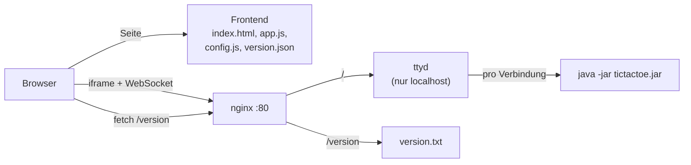

# Web-Konsole – TicTacTest im Browser (Auftrag 1)

TicTacTest bleibt eine Konsolen-Applikation. Im Browser läuft **das unveränderte Jar aus
dem GitHub Release**: Eine Web-Konsole startet für jede Verbindung `java -jar` und
überträgt Ein- und Ausgabe in ein Terminal im Browser. Ein kleines, getrennt
ausgeliefertes Frontend bettet dieses Terminal ein.



## Werkzeug: ttyd

| Werkzeug | Bewertung |
|---|---|
| **[ttyd](https://github.com/tsl0922/ttyd) 1.7.7** – gewählt | Statisches Binary ohne Abhängigkeiten, echtes Pseudo-Terminal (ANSI-Farben und Fettschrift des Spielbretts funktionieren), xterm.js ist eingebaut, aktiv gepflegt. Pro Verbindung ein eigener Prozess. |
| GoTTY | Gleiches Prinzip, aber seit Jahren kaum gepflegt. |
| websocketd | Überträgt nur Textzeilen, kein Terminal: eigene HTML/JS-Seite nötig, ANSI-Codes müssten selbst übersetzt werden. |

### Wie es funktioniert

1. Der Browser lädt die Seite von ttyd (xterm.js) und öffnet einen **WebSocket** auf `/ws`.
2. Für **jede Verbindung** startet ttyd den konfigurierten Befehl in einem neuen
   **Pseudo-Terminal** (PTY): `java -jar tictactoe.jar`. Das Jar meint, es laufe in
   einem normalen Terminal.
3. Tastendrücke gehen über den WebSocket in den PTY (stdin), die Ausgabe (stdout mit
   ANSI-Farben) zurück an xterm.js.

### Aufruf

```bash
ttyd --interface lo --port 7681 --writable --max-clients 10 \
     --client-option titleFixed=TicTacTest \
     java -XX:+UseSerialGC -Xmx32m -jar /opt/tictactest/current/tictactoe.jar
```

| Option | Warum |
|---|---|
| `--writable` | **Ohne diese Option kann man nicht tippen.** ttyd ist seit 1.7 standardmässig read-only. |
| `--interface lo` | ttyd ist nur über localhost erreichbar, von aussen nur über nginx |
| `--max-clients 10` | Jede Verbindung ist eine JVM, siehe unten |
| `-Xmx32m -XX:+UseSerialGC` | Das Spiel braucht wenige MB. Ohne Limit reserviert jede JVM ¼ des RAM. |

## Beobachtungen

| Situation | Verhalten |
|---|---|
| **Spielende** (Sieg, Niederlage, Remis) | `main()` endet und die JVM beendet sich. ttyd schliesst die Verbindung, xterm.js zeigt *Press ⏎ to Reconnect*. |
| **Neues Spiel** | <kbd>Enter</kbd> drücken (oder Seite neu laden): neue Verbindung, also neue JVM und neue Partie |
| **Ungültige Eingabe** (besetztes Feld, `9`) | Das Spiel wirft eine `IllegalStateException`, der Stacktrace erscheint im Terminal, die Partie ist beendet. Das ist Originalverhalten des Jars, es wird nicht verändert. |
| **Text statt Zahl** (`a`) | `InputMismatchException`, ebenfalls Ende der Partie |
| **Zwei Tabs** | Zwei unabhängige Partien, **zwei Java-Prozesse**: gemessen je ~45 MB RSS (`-Xmx32m`). |

**1 GB RAM:** Betriebssystem und nginx brauchen ~300 MB. Mit ~45 MB pro Partie passen
rechnerisch ~15 Spiele, ohne Heap-Limit wären es nur 3–4 (jede JVM würde bis 256 MB
reservieren). `--max-clients 10` lässt Reserve: Der elfte Besucher wird abgewiesen,
statt dass die Instanz wegen Speichermangel ausfällt.

## Sicherheit

Die Web-Konsole ist für alle erreichbar, die die URL kennen. Deshalb:

- **ttyd startet nur das Jar, nie eine Shell.** Mit `ttyd --writable bash` (oder `sh`,
  `login`) hätte jeder Besucher eine Shell auf dem Server: Dateien lesen, die
  Credentials des Instance Profiles über den Metadaten-Dienst holen und AWS-Ressourcen
  verändern, Malware starten, die Instanz für Angriffe auf andere missbrauchen.
- Das Jar startet nichts anderes. Endet es, ist die Verbindung zu Ende, es bleibt
  keine Shell übrig.
- ttyd läuft als **eigener Systembenutzer `tictactest`** ohne Login-Shell und ohne
  Home-Verzeichnis, nicht als `root`; systemd mit `NoNewPrivileges`,
  `ProtectSystem=strict`, `ProtectHome`, `PrivateTmp`. Lokal: Container mit
  read-only Dateisystem und `no-new-privileges`.
- ttyd lauscht nur auf `localhost`. Von aussen ist nur nginx auf Port 80 offen.
- `--max-clients` begrenzt, wie viele JVMs ein Besucher (oder ein Bot) starten kann.
- Offen bleibt: kein HTTPS (Learner Lab ohne eigene Domain), keine Anmeldung. Für ein
  Spiel ohne Daten ist das vertretbar, für mehr nicht.

## Versionsabfrage

`GET /version` liefert die Version des laufenden Jars als Text, z. B. `1.2.0`.

- Die Version stammt **aus dem Release-Tag** (`v1.2.0` → `1.2.0`), nicht aus einer
  Datei, die jemand pflegt. Beim Deployment schreibt
  `tictactest-deploy` sie als `version.txt` **in dasselbe Verzeichnis wie das Jar**
  (`/opt/tictactest/releases/1.2.0/`). `current` ist ein Symlink auf dieses
  Verzeichnis. Jar und Version wechseln also gemeinsam und atomar.
- nginx liefert die Datei unter `/version` aus, mit `Access-Control-Allow-Origin: *`
  (das Frontend liegt auf einem anderen Origin) und `Cache-Control: no-store` (die
  Pipeline soll nie eine alte Version sehen).
- Alternativen: Dateiname des Jars (`tictactoe-1.2.0.jar`) – geht verloren, sobald es
  umbenannt wird; Manifest im Jar – enthält bisher keine Version, dafür müsste der
  Build geändert werden.

## Frontend

Ordner [`frontend/`](../frontend/), plain HTML/CSS/JavaScript ohne Framework und ohne
Build-Step:

| Datei | Inhalt |
|---|---|
| `index.html` | Titel, Spielregeln, Terminal als `<iframe>`, beide Versionen |
| `style.css` | Darstellung |
| `app.js` | setzt die URL des iframes, liest `version.json` (Frontend) und `<Web-Konsole>/version` (Backend) |
| `version.json` | Frontend-Version; im Repo `dev`, im Release-Archiv vom Tag geschrieben |
| `config.js` | **URL der Web-Konsole pro Umgebung**, wird vor `app.js` geladen |

Die URL steht nicht im Code: `app.js` liest `window.TICTACTEST_CONFIG.webConsoleUrl`.
`config.js` im Repo zeigt auf `http://localhost:8080/` (lokal). Auf S3 schreibt
**OpenTofu** die Datei mit dem DNS-Namen der Instanz (`aws_s3_object.frontend_config`),
denn nur die Infrastruktur kennt diese Adresse. Das Release-Archiv enthält **kein**
`config.js`, und das Frontend-Deployment schliesst die Datei aus.

## Lokal starten – nur aus Release-Assets

```bash
webconsole/start-local.sh v1.2.0
```

Das Skript lädt Jar und Frontend-Archiv vom GitHub Release (kein lokaler Build),
schreibt `version.txt` aus dem Tag, legt das lokale `config.js` dazu und startet mit
Docker Compose ([`webconsole/compose.yaml`](../webconsole/compose.yaml)) **zwei
getrennte Server**, wie in der Cloud:

| URL | Dienst |
|---|---|
| <http://localhost:8000> | Frontend (nginx, statisch), entspricht S3 |
| <http://localhost:8080> | Web-Konsole: nginx → ttyd (Corretto 25), `/version` |

Ergebnis des Tests: Das Terminal wird eingebettet und ist bedienbar, beide Versionen
werden angezeigt. Ohne den CORS-Header auf `/version` würde die Entwickler-Konsole
*"blocked by CORS policy: No 'Access-Control-Allow-Origin' header"* melden, und die
Backend-Version bliebe *unbekannt*. Das iframe funktioniert auch ohne CORS, weil Einbetten nicht unter die
Same-Origin-Policy fällt.

Aufräumen: `docker compose -f webconsole/compose.yaml down`.

## Release

Ein Tag `v*` erzeugt mit [`release.yml`](../.github/workflows/release.yml) einen
GitHub Release mit:

| Asset | Inhalt |
|---|---|
| `tictactoe-X.Y.Z.jar` | das Spiel (Backend), unverändert |
| `tictactest-frontend-X.Y.Z.zip` | Inhalt von `frontend/` ohne `config.js`, mit `version.json` = `X.Y.Z` |

**Was gehört nicht zum Release?** systemd-Unit, nginx-Konfiguration, ttyd-Version und
das Deploy-Skript gehören zur **Infrastruktur** ([`infra/cloud-init.yaml.tftpl`](../infra/cloud-init.yaml.tftpl)).
Sie legen fest, *wie* eine Version betrieben wird, nicht *welche*. Sie ändern sich
selten und unabhängig vom Spiel, und eine Änderung daran soll über `tofu plan` sichtbar
werden. Der Release enthält nur, was sich pro Version ändert.

**Warum auch das Frontend als Release-Asset?** Ein Release ist dann ein unveränderliches,
vollständiges Paket: Genau diese Dateien wurden getestet und werden deployt, egal was
inzwischen auf `main` liegt. Ein Rollback auf `v1.2.0` liefert exakt das damalige
Frontend aus, ohne Checkout oder Build. Und die Pipeline baut für das Deployment nichts
neu.
